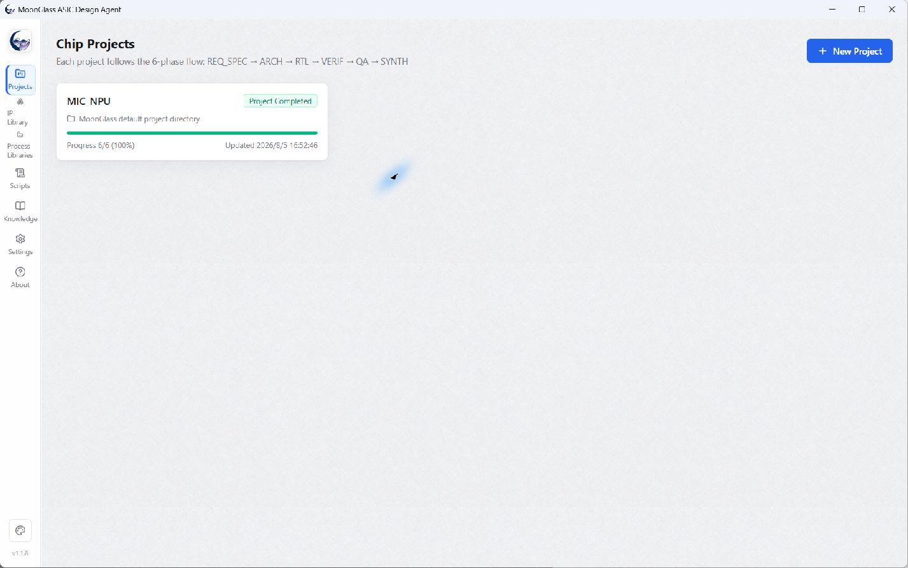
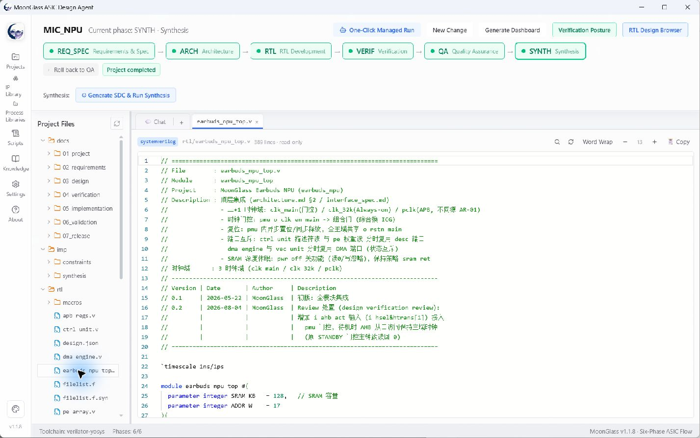
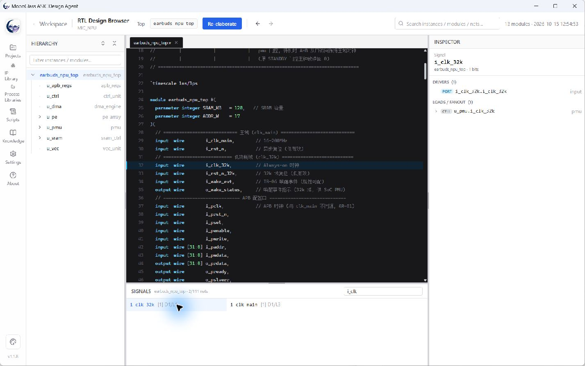

# MoonGlass ASIC Design Agent

English | [简体中文](./README.md)

**An AI-assisted engineering workbench for ASIC/SoC development—from requirements and architecture to RTL, verification, quality review, and synthesis.**

MoonGlass connects agent conversations with project files, EDA tools, stage gates, and verification evidence. Engineers can inspect outputs, intervene in decisions, and resume long-running work rather than treating generated RTL as a finished design.

Current product version: **v1.1.8 · Windows x64**

[Download portable ZIP](https://github.com/MoonGlassAgent/MoonGlass/releases/tag/v1.1.8) · [English quick start](https://moonglassagent.github.io/MoonGlass/index.en.html) · [Documentation](https://moonglassagent.github.io/MoonGlass/) · [Issues](https://github.com/MoonGlassAgent/MoonGlass/issues)

## What it does

- **Six engineering stages:** requirements/specification → architecture → RTL → verification → quality assurance → synthesis.
- **Agent sessions and workflow control:** task-level conversations, model selection, context management, pause/resume, and human decisions.
- **Evidence-oriented verification:** specification mapping, verification intents, scenarios, checkers/oracles, regression results, coverage gaps, and residual risks.
- **RTL Design Browser:** inspect hierarchy and source, trace signal drivers/loads, and navigate across modules.
- **EDA integration:** workflows using tools such as Verible, Slang, Verilator, Icarus Verilog, Cocotb, Yosys, and SymbiYosys. Availability depends on the configured toolchain.
- **Module-level UT:** isolated diagnostic sessions; module checks do not replace required TOP-level regression.

Verification results and agent summaries remain subject to engineering review. MoonGlass is not a replacement for sign-off responsibility or a guarantee of tape-out readiness.

## Screenshots

Actual v1.1.8 application screens in English, captured with an isolated MIC_NPU demo profile. Project documents may retain their original language; no private projects or API credentials are shown.

## Quick start

1. Download the Windows x64 ZIP and `SHA256SUMS.txt` from [v1.1.8 Releases](https://github.com/MoonGlassAgent/MoonGlass/releases/tag/v1.1.8).
2. Extract the **entire** archive to a writable folder. Run `MoonGlass.exe` or `Start-MoonGlass.bat`; there is no installer to run.
3. Open **Settings** and select **English** if needed. Configure your model provider, API key, base URL, and model. API credentials are not included.
4. Check the development environment and EDA tools in Settings. The package includes selected runtimes, not every tool listed above.
5. Open the bundled MIC_NPU demo, create a project, or import an existing workspace. Review stage outputs and evidence before advancing.

Portable data is stored in the application's `userdata` directory. Keep that directory when backing up your projects and settings, and do not commit credentials or agent conversations to GitHub.

## What this repository contains

This is a **partial source publication**, not the complete application build repository. It contains public UI code, internationalization resources, shared contracts, workflow presentation logic, and documentation.

It does **not** include the complete agent runtime, EDA execution layer, RTL/specification parsing engine, verification execution engine, or private development history. There is no `package.json`: running `pnpm install` in this public checkout will not build or start MoonGlass.

Use the portable release to run the product. Public source and release binaries are not a one-to-one reproducible build. See [Public source scope](./PUBLIC-SOURCE-SCOPE.md) (Chinese) for the publication boundary.

## Verification approach

MoonGlass's AIGV workflow links specification semantics → verification intents → scenarios → stimulus and checkers/oracles → evidence → risk conclusions. A recorded PASS is not automatically current evidence after an RTL change. Unresolved risks, missing evidence, and human approvals are part of the engineering workflow.

Further reading (Chinese): [AIGV methodology](https://moonglassagent.github.io/MoonGlass/MoonGlass-AIGV验证方法学.html) · [User manual](./docs/USER-MANUAL-ZH-CN.md) · [Version notes](./RELEASE-NOTES-v1.1.8-ZH-CN.md).

## License and commercial use

MoonGlass is **Source Available, not OSI-approved open source**.

- Noncommercial use is governed by the [PolyForm Noncommercial License 1.0.0](./LICENSE).
- Commercial use—including internal commercial R&D, customer delivery, paid services, tape-out, or production—requires a separate written commercial license. See [Commercial licensing](./COMMERCIAL-LICENSE.md).
- Third-party tools and runtimes retain their respective licenses: [Third-party notices](./THIRD-PARTY-NOTICES.md).

User-provided designs and outputs remain owned by their respective rights holders. Publication of source or availability of a binary does not waive the license conditions.

## Contact

[GitHub Issues](https://github.com/MoonGlassAgent/MoonGlass/issues) for questions and reproducible problems; **moonglassagent@126.com** for commercial licensing, private deployment, EDA integration, and security reports. Do not include API keys, customer designs, or restricted IP in public issues.
